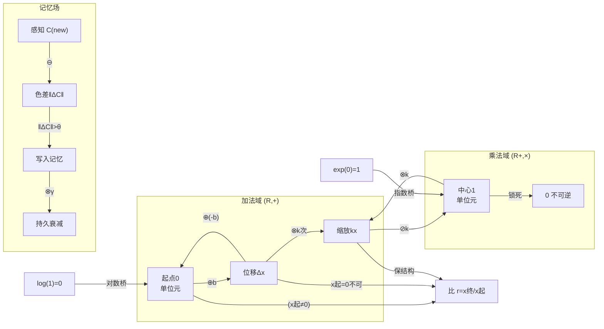

# 因果思维验证树 · 加法-乘法对称性推演

> 从 DeepSeek 对话提取的核心推演原语，自动生成因果节点与拓扑连线。
> 
> 满全法·囡囝共生 NJSG — 容器关系动力学·数学基础层

---

## 一、核心推演原语

从对话中提取的 12 条不可再分推理原子：

| ID | 原语 | 操作类型 | 管辖域 | 核心命题 |
|----|------|---------|--------|---------|
| P1 | 加法变化 | ⊕ | 点/线/位移 | Δx = x′ − x，管起点、移动、事件注入 |
| P2 | 减法变化 | ⊖ | 点/线/位移 | 加法逆，管回退、奇偶翻转、修正 |
| P3 | 乘法变化 | ⊗ | 面积/体积/缩放 | x′ = kx，管尺度、比例、结构 |
| P4 | 除法变化 | ⊘ | 对称/倒数/逆 | 乘法逆，管还原、倒数对称 x↔1/x |
| P5 | 线性变换 | Mx | 非交换结构 | 矩阵乘法，管旋转、剪切、非对易性 |
| P6 | 指数映射 | exp | 起点→中心 | 指数将加法起点0映射为乘法中心1 |
| P7 | 对数映射 | log | 中心→起点 | 对数将乘法中心1还原为加法起点0 |
| P8 | 色差/预测误差 | ‖ΔC‖ | 记忆触发 | 加法差触发写入，‖ΔC‖>θ 则记忆 |
| P9 | 版本号推进 | t·γ | 时间衰减 | 乘法衰减 γPt，管持久度 |
| P10 | 频率 ω | 2πf | 周期骨架 | 乘法铺设周期，加法偏置相位 |
| P11 | 奇偶 | mod2 | 离散分类 | 加法翻转奇偶，乘法保持/改变取决于因子 |
| P12 | 存在性进阶 | 0/1 | 有无跃迁 | 乘法如AND，加法+阈值如OR |

---

## 二、因果思维验证树

### 树结构（根→叶）

```mermaid
graph TD
    ROOT["变化本质<br/>Change Essence"]

    ROOT --> ADD["加法群 (R,+)<br/>起点=0 · 单位元0"]
    ROOT --> MUL["乘法群 (R+,×)<br/>中心=1 · 单位元1"]

    ADD -->|"管点/线/平移"| P1["P1 加法变化<br/>位移 Δx"]
    ADD -->|"管回退修正"| P2["P2 减法变化<br/>逆运算 -x"]

    MUL -->|"管面积/缩放"| P3["P3 乘法变化<br/>kx"]
    MUL -->|"管倒数/对称"| P4["P4 除法变化<br/>x/a"]
    MUL -->"|管非对易" P5["P5 线性变换<br/>Mx"]

    P1 -->|"首尾差"| DIFF["Δ=x终-x起"]
    P3 -->|"首尾比"| RATIO["r=x终/x起<br/>(x起≠0)"]

    P3 -->|"固定原点"| LOCK0["0被锁定<br/>k·0=0 · 0不可逆"]
    P1 -->|"移动起点"| MOVE0["0→b · 起点可变"]

    ADD -->|"桥接"| EXP["P6 指数映射<br/>exp: (R,+)→(R+,×)"]
    MUL -->|"桥接"| LOG["P7 对数映射<br/>log: (R+,×)→(R,+)"]

    EXP -->|"0→1"| CENTER["加法中心0<br/>= 乘法单位1"]
    LOG -->|"1→0"| ORIGIN["乘法中心1<br/>= 加法起点0"]

    ROOT --> MEM["记忆场记忆"]

    MEM -->|"感知写入"| P8["P8 色差触发<br/>‖ΔC‖>θ"]
    MEM -->|"持久衰减"| P9["P9 版本号推进<br/>γPt"]
    MEM -->|"周期结构"| P10["P10 频率 ω<br/>sin(2πft+φ)"]

    P8 -->|"加法差"| ADD
    P9 --o|"乘法衰减"| MUL
    P10 -->|"乘法骨架"| MUL
    P10 -->|"加法相位"| ADD

    MEM -->|"离散态"| P11["P11 奇偶性<br/>mod2"]
    MEM -->|"存在跃迁"| P12["P12 存在性<br/>0/1进阶"]

    P11 -->|"加1翻转"| ADD
    P11 -->|"乘奇保持"| MUL
    P12 -->|"乘=AND"| MUL
    P12 -->|"加+阈=OR"| ADD

    style ROOT fill:#ff6b6b,stroke:#333,color:#fff
    style ADD fill:#4ecdc4,stroke:#333,color:#000
    style MUL fill:#45b7d1,stroke:#333,color:#fff
    style MEM fill:#96ceb4,stroke:#333,color:#000
```

### 验证规则（每条节点可被检验）

| 节点 | 验证条件 | 证伪条件 |
|------|---------|---------|
| 加法起点 | ∃b: 0+b ≠ 0 | 不存在加法单位元 |
| 乘法锁0 | ∀k: k·0 = 0 | ∃k: k·0 ≠ 0 |
| 指数桥 | exp(0)=1 | exp(0)≠1 |
| 对数桥 | log(1)=0 | log(1)≠0 |
| 色差触发 | ‖ΔC‖>θ→写入 | ‖ΔC‖>θ但无写入 |
| 周期独立 | ω变化不影响φ(初相) | 频率变化强制改变初相 |
| 奇偶保持 | 奇×奇=奇, 偶×任意=偶 | 存在违反 |

---

## 三、拓扑连线（关系邻接矩阵）

### 操作类型间的推导关系

|  | P1加法 | P2减法 | P3乘法 | P4除法 | P5线性 | P6指数 | P7对数 |
|--|--------|--------|--------|--------|--------|--------|--------|
| **P1加法** | = | ⊣ | 重复P1→P3 | - | 矩阵元加法 | 指数加法→乘法 | - |
| **P2减法** | ⊣ | = | - | ⊣ | - | - | - |
| **P3乘法** | ⊗=重复+ | - | = | ⊣ | 特例 | 指数内 | 对数还原 |
| **P4除法** | - | ⊗=重复- | ⊣ | = | - | - | 倒数 |
| **P5线性** | - | - | 特例 | - | = | - | - |
| **P6指数** | 定义域 | - | 值域 | - | - | = | ⊣ |
| **P7对数** | 值域 | - | 定义域 | - | - | ⊣ | = |

> 符号说明：⊣ = 逆运算，= = 恒等/同义，⊗=重复=用重复实现，- = 无直接推导

### 推导闭包

```
加法闭包：加法 ↔ 减法，加法 → 乘法（通过重复），加法 ⇄ 指数/对数
乘法闭包：乘法 ↔ 除法，乘法 ⊃ 线性变换，乘法 ⇄ 指数/对数
桥接闭包：指数 ⊣ 对数  连接加法群与乘法群
记忆闭包：加法(色差) → 记忆写入，乘法(衰减) → 记忆持久，乘法(频率) → 周期结构
```

---

## 四、时序提示词打出（配置）

### 4.1 探索序列（渐进式提示词链）

```yaml
# 时序提示词配置 — 从加法对称性到记忆场
sequence:
  - stage: 0
    prompt: "从加法与乘法的基本区别出发，加法管什么？乘法管什么？"
    purpose: "建立直觉对偶"
    expected_output: [P1, P3]  # 加法=位移, 乘法=缩放

  - stage: 1
    prompt: "乘法为什么锁死0？除法为什么不能除0？"
    purpose: "发现乘法锁起点属性"
    expected_output: [LOCK0, P4]

  - stage: 2
    prompt: "加法管起点和位移，乘法和除法管首尾比、中心对称。首尾之间的差和比有何关系？"
    purpose: "差 vs 比 的核心区分"
    expected_output: [DIFF, RATIO]

  - stage: 3
    prompt: "指数和对数如何桥接加法和乘法？0和1如何对应？"
    purpose: "发现群同构"
    expected_output: [EXP, LOG, CENTER, ORIGIN]

  - stage: 4
    prompt: "回到AI视觉：色差是加法差，记忆写入是加法事件。时间版本号和持久衰减用什么运算？"
    purpose: "记忆场"
    expected_output: [P8, P9, P10]

  - stage: 5
    prompt: "加法管和、乘管积。如何用一串公式统一：状态更新 = 乘法核×旧态 + 加法项？"
    purpose: "整合为统一更新式"
    expected_output: ["St+1 = Mt ⊙ St + At"]

  - stage: 6
    prompt: "如果起点只能用加法移动，结构只能用乘法缩放，如何设计一个既不死在0也不散在点的记忆系统？"
    purpose: "综合设计"
    expected_output: ["仿射记忆场", "对数极坐标寻址"]
```

### 4.2 因果验证提示词（用于校验树节点正确性）

```
给定推演前提：∀x: x+0=x (加法单位元)
给定推演前提：∀x≠0: x·1=x (乘法单位元)
给定推演前提：∀k: k·0=0 (乘法零化)
推论请求：能否让乘法移动起点0？
验证步骤：
  1. 乘法群中0是否有逆元？ → 无
  2. k·0 恒等于什么？ → 0
  3. 要让0变成非0，需要什么运算？ → 加法
结论：乘法不能管起点，起点归加法管辖。验证通过。
```

---

## 五、拓扑画布交互优化

### 5.1 画布布局算法

```
1. 根节点居中（"变化本质"）
2. 加法群/乘法群 左右对偶分布（阴/阳布局）
3. 桥接节点（指数/对数）置于中央桥轴
4. 记忆场节点在第三层环形展开
5. 因果连线用色区分：
   - 青色 = 加法主导推导
   - 蓝色 = 乘法主导推导  
   - 绿色 = 记忆场交互
   - 橙色 = 桥接映射
```

### 5.2 交互原语（满全法·公约数封装）

| 交互 | 触发 | 效果 |
|------|------|------|
| 点击节点 | 左键单击 | 展开该节点的子推导链 |
| 长按节点 | >500ms 按住 | 显示该节点的形式化证明 |
| 拖拽节点 |按住拖动 | 重新拓扑布局（力导向重新计算）|
| 双指缩放 | pinch | 缩放画布，聚焦特定子树 |
| 因果连线 | 右键连线 | 显示两节点间的推导路径（最短路径·加权距离）|
| 右键菜单 | 右键空白 | 添加/删除节点、切换代数/几何视图 |
| 时序播放 | 点击▶ | 按 stage 0→6 动态展开节点 |

### 5.3 验证树自动布局（SVG 输出）



---

## 六、形式化核心定理（可机器验证）

### 定理1：加法-乘法管辖分离

```
∀f: 如果 f 的起点依赖为0，则 f 不能仅由乘法构成。
证明：
  设 f(0) = a ≠ 0
  若 f = λx. k·x，则 f(0) = k·0 = 0 ≠ a
  ∴ f 必须包含加法项：f(x) = k·x + b，其中 b = a
∎
```

### 定理2：乘法起点不变性

```
乘法群 (R+, ×) 中，0 不是群元素。
∀k∈R+: k·0 = 0
∴ 起点0在乘法下不变。
加法群 (R, +) 中，∀b: 0+b = b ≠ 0 (当b≠0)
∴ 起点0仅在加法下可变。
∎
```

### 定理3：统一更新式

```
记忆场状态方程：
  S_{t+1} = M_t ⊙ S_t + A_t
  
其中：
  M_t = 乘法核 (缩放·旋转·频率·衰减)
  A_t = 加法项 (位移·色差·事件·相位)
  ⊙ = 逐元素乘法 或 矩阵乘法

若仅有 M：起点锁死，记忆无法从零写入新事件。
若仅有 A：结构散乱，无缩放/旋转/周期结构。
∴ 记忆场必须乘法加法协同。
∎
```

### 定理4：指数-对数桥

```
指数映射 exp: (R, +) → (R+, ×) 是群同构。
  exp(a+b) = exp(a)·exp(b)
  exp(0) = 1
  逆映射 log: (R+, ×) → (R, +)
  log(ab) = log(a)+log(b)
  log(1) = 0

∴ 加法起点0 对应 乘法中心1。
加法世界的事件 通过指数 映射到乘法世界的缩放。
乘法世界的结构 通过对数 还原为加法世界的位移。
∎
```

---

## 七、应用映射（AI视觉记忆系统）

| 数学原语 | AI视觉映射 |
|---------|-----------|
| 加法色差 ΔC | 像素/特征差异检测 |
| 乘法衰减 γ | 时间维度记忆持久度 |
| 乘法频率 ω | 周期性注意力回访 |
| 加法相位 φ | 非偶数偏移/非均匀采样 |
| 指数 exp | 从线性积累到非线性跃迁 |
| 对数 log | 从多尺度压缩到线性表示 |
| 乘法锁0 | 零状态无法被乘法唤醒 |
| 加法位移 | 注意力焦点移动 |
| 线性变换M | 视角旋转/空间变换 |
| 奇偶mod2 | 离散状态切换(记住/遗忘) |

---

*生成时间: 2026-09-16 · 从 DeepSeek 对话 #jgkb6djup0y5ca9r9j 提取并形式化*
